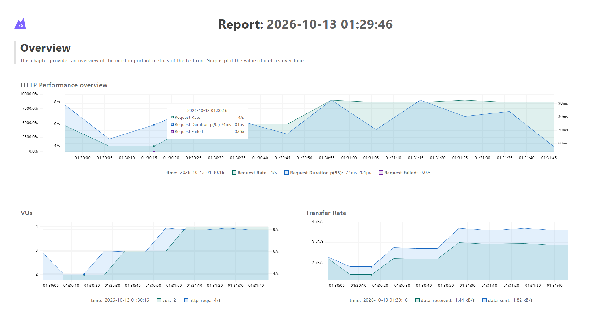
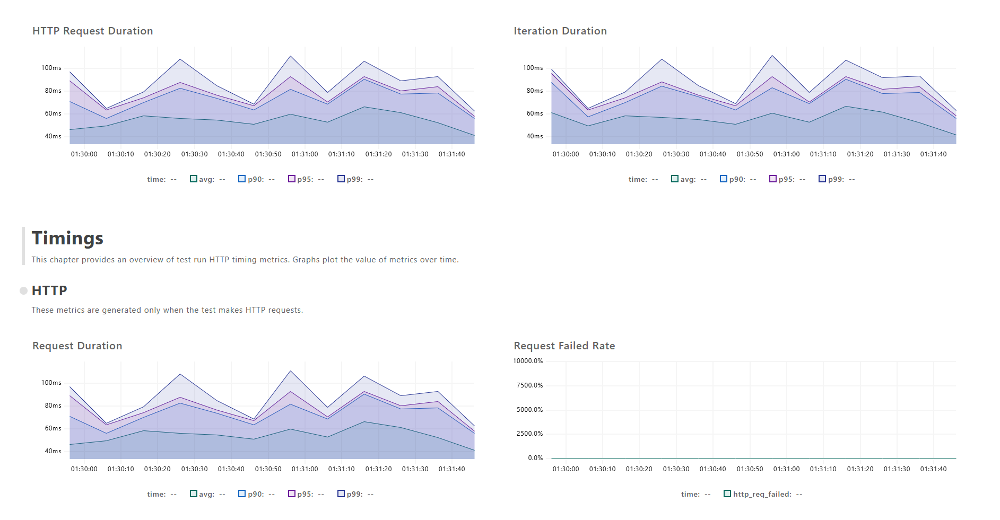
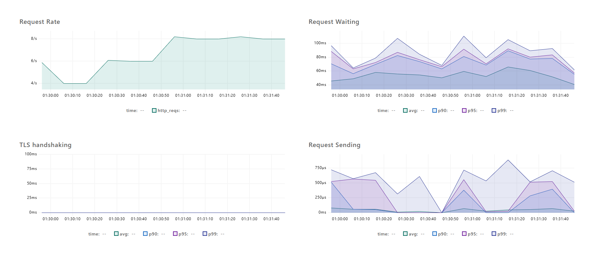
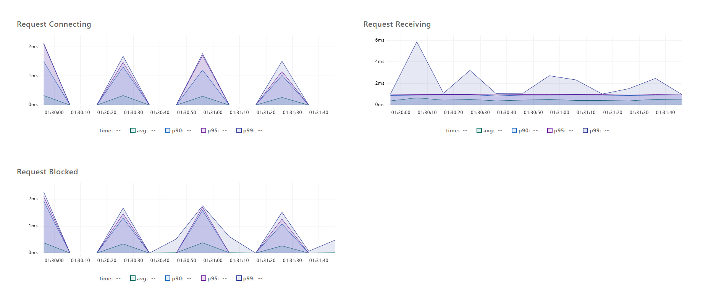
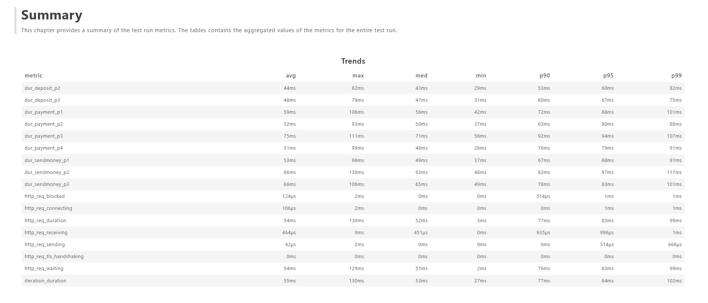
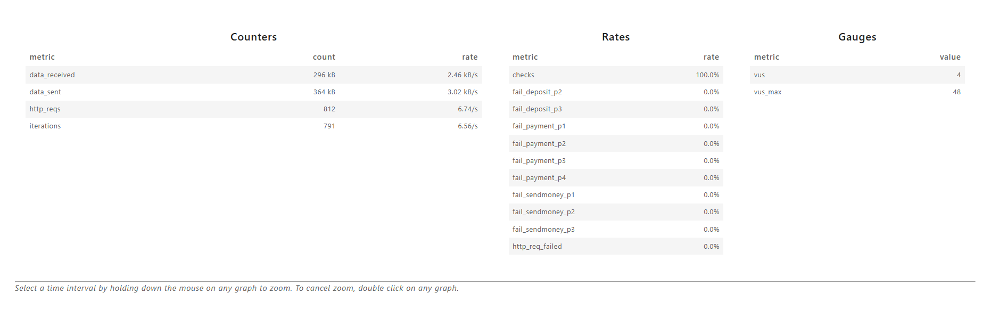

# DMoney k6 Performance Test

k6 load test for the DMoney transaction APIs: **`/transaction/deposit`**, **`/transaction/sendmoney`**, **`/transaction/payment`**.
Six users (2 agents, 2 customers, 2 merchants) run a 2-minute, four-phase workload. Each user logs in with their own credentials.

## Workload (2 minutes)

| Phase | Concurrent activities |
|---|---|
| 0-30s | Customer1 → Customer2 (send money) · Customer2 → Merchant1 (payment) |
| 30-60s | Customer2 → Customer1 (send money) · Agent1 → Customer2 (deposit) · Customer1 → Merchant1 (payment) |
| 60-90s | Agent1 → Customer1 (deposit) · Agent2 → Customer2 (deposit) · Customer1 → Customer2 (send money) · Customer2 → Merchant2 (payment) |
| 90-120s | Agent1 → Merchant1 · Agent2 → Merchant2 · Customer1 → Merchant1 · Customer2 → Merchant2 (all payments) |

Each activity is its own k6 scenario (`constant-arrival-rate`, default 2 req/s, `startTime` = phase start, 30s duration), so activities in the same phase run concurrently for the whole phase.

## Authentication

`POST /user/login` → `POST /user/verify-otp?env=dev` with the backend `DEFAULT_OTP` (`0000`) → JWT. Done once per user in `setup()`. Every transaction uses the sender's own token plus `X-AUTH-SECRET-KEY`.

## Checks (per transaction)

1. HTTP status is `201`
2. Transaction successful (status 201, no `error` field, message contains "successful")
3. `trnxId` is returned
4. Expected message: `Deposit successful` / `Send money successful` / `Payment successful`

## Thresholds

| Scope | Rule |
|---|---|
| Global | `http_req_failed < 1%`, `http_req_duration p(95) < 1000ms`, `checks >= 99%` |
| Deposit, Send Money, Payment (each) | same three rules, using the `api` tag |

Note: the backend returns `208` for "Insufficient balance" and `400`/`403`/`500` for other rejections. The script treats only `201` as expected, so all of these count as failed requests.

## Setup & run

```bash
# 1. start the DMoney API (port 5000) and make sure the 6 users exist
# 2. edit config/users.json with the real phone numbers / passwords
# 3. run
k6 run dmoney-transactions.js

# run + generate HTML report (works on Windows, macOS and Linux; needs k6 >= 0.49)
k6 run -e SEED=true --out web-dashboard=export=results/report.html dmoney-transactions.js
```

Debug failures: `k6 run -e DEBUG=true dmoney-transactions.js` prints the first failing responses (status + body).

Options (env vars): `SEED` (see below), `BASE_URL` (default `http://localhost:5000`), `PARTNER_KEY`, `OTP`, `RATE` (req/s per activity), `AMOUNT` (default 10), `PHASE_SECONDS`.

## Prerequisites (test data)

Verified against the backend source (`deposit/sendMoney/payment.controller.js`, `limitChecker.js`):
- Deposit: only an Agent can send, and a regular agent can only deposit to a **Customer** (min 10, customer balance cap 10,000).
- Send money: **Customer → Customer** only. Payment: **Customer or Agent → Merchant** only.
- Customers have daily/monthly count and amount limits on send money and payment (default 10/day). Raise them with `sql/raise-limits.sql`.
- A fee is charged on send money and payment on top of `AMOUNT`, so balances drop slightly faster than `AMOUNT` alone.

**Auto-seeding:** run with `-e SEED=true` and `setup()` logs in as `SYSTEM` (`SYSTEM_PASSWORD`, default `1234`), tops each agent up to `SEED_AGENT_AMOUNT` (10,000) and brings each customer to about `SEED_CUSTOMER_AMOUNT` (3,000). Below target it deposits the shortfall via agent1; above target it pays the excess to merchant1, so a customer left near the 10,000 balance cap by earlier runs is reset. It is safe to re-run. Raise the customer limits first (`sql/raise-limits.sql`), otherwise the draining payment can be rejected. SYSTEM must have enough balance. Seed calls are tagged `seed_*` and are outside the per-API metrics.


The test does not create users or balances. Before running:

| Requirement | Why / what you see if missing |
|---|---|
| All 6 users exist with the right roles and are **active** | `403 Merchant account is not active` |
| Agents funded (deposit from SYSTEM, ~5,000 each for AMOUNT=10) | `208 Insufficient balance` on deposits / agent payments |
| Customers have some starting balance and are below the balance cap | `Insufficient balance` / `Limit exceeded. You cannot deposit any more` |
| Customer transaction limits raised for the test (`sql/raise-limits.sql`) | `Daily transaction limit reached ... 10 allowed transactions` |

After testing, restore the defaults with `sql/revert-limits.sql`. Each run uses about 240 outgoing transactions per customer; the monthly count is checked too, so `raise-limits.sql` sets very high limits to allow many runs.

**Recommended backend fix (applied for the final run):** `Transactions` has no index on `account`, but every transaction runs `SELECT ... WHERE account = ? FOR UPDATE`, which scans and locks rows across the whole table and caused `500 Deadlock` errors under concurrency. Run `CREATE INDEX idx_transactions_account ON Transactions (account);` (see `sql/optional-add-account-index.sql`) and restart the backend. The before/after comparison is in Results.

Without the index, overlapping writes on the same customer accounts return `500 Deadlock found when trying to get lock` (seen in the 60-90s phase). The script treats this as a failure and does not retry it.

Outputs: `results/report.html` (web dashboard), `results/summary.json`, `results/comparison.md` (per-API and per-phase table). Add your screenshots as `screenshots/summary.png`, `screenshots/html-report.png` and `screenshots/metrics.png`.

## Results

Real runs against the DMoney backend (Node/Express + MySQL), 2 minutes, 2 req/s per activity, `AMOUNT=10`, test data seeded with `SEED=true`. The same test was run twice on the same backend: first without an index on `Transactions.account` (baseline), then with `CREATE INDEX idx_transactions_account ON Transactions (account)` and a backend restart. The index was the only change.

### Console summary
.png>)
.png>)

### HTML report





### Metrics



Full report: [`results/report.html`](results/report.html) - raw data: [`results/summary.json`](results/summary.json)

### Threshold results (final run, with index)

| Scope | Failed < 1% | p(95) < 1000 ms | Checks >= 99% |
|---|---|---|---|
| Global | 0.00% - pass | 83.7 ms - pass | 100.00% - pass |
| Deposit | 0.00% - pass | 65.4 ms - pass | 100.00% - pass |
| Send money | 0.00% - pass | 86.7 ms - pass | 100.00% - pass |
| Payment | 0.00% - pass | 87.7 ms - pass | 100.00% - pass |

All 812 requests succeeded and all 3,164 checks passed.

### API comparison (final run, with index)

| API | Requests | Throughput (req/s) | avg ms | p90 ms | p95 ms | max ms | Failure % |
|---|---|---|---|---|---|---|---|
| deposit | 182 | 1.52 | 47.1 | 59.8 | 65.4 | 82.7 | 0.00 |
| sendmoney | 182 | 1.52 | 62.3 | 78.0 | 86.7 | 130.1 | 0.00 |
| payment | 427 | 3.56 | 56.1 | 80.0 | 87.7 | 111.8 | 0.00 |

Throughput is the offered load (constant arrival rate), not the backend's maximum: all 791 iterations completed, at most 4 VUs were busy, and nothing was dropped.

### Degradation across phases (final run, with index)

p95 ms / failure % / requests:

| API | 0-30s (2 activities) | 30-60s (3) | 60-90s (4) | 90-120s (4, payments only) |
|---|---|---|---|---|
| deposit | - | 60.1 / 0.0% / 61 | 67.5 / 0.0% / 121 | - |
| sendmoney | 69.0 / 0.0% / 61 | 87.9 / 0.0% / 61 | 83.2 / 0.0% / 60 | - |
| payment | 88.6 / 0.0% / 61 | 80.1 / 0.0% / 61 | 94.1 / 0.0% / 61 | 80.0 / 0.0% / 244 |

Average response time (ms):

| API | 0-30s | 30-60s | 60-90s | 90-120s |
|---|---|---|---|---|
| deposit | - | 44.3 | 48.6 | - |
| sendmoney | 53.6 | 66.9 | 66.7 | - |
| payment | 59.8 | 52.5 | 75.5 | 51.2 |

### Before vs after the index

| Metric | Before (no index) | After (index) |
|---|---|---|
| Failed requests (overall) | 12.15% | 0.00% |
| Checks passed | 87.54% | 100.00% |
| p95 response time (overall) | 321.9 ms | 83.7 ms |
| avg response time (overall) | 146.9 ms | 54.6 ms |
| Deposit: failures / p95 | 20.77% / 249.4 ms | 0.00% / 65.4 ms |
| Send money: failures / p95 | 14.84% / 362.8 ms | 0.00% / 86.7 ms |
| Payment: failures / p95 | 7.82% / 331.2 ms | 0.00% / 87.7 ms |
| 60-90s p95: deposit / sendmoney / payment | 278.5 / 411.8 / 383.0 ms | 67.5 / 83.2 / 94.1 ms |
| 60-90s failures: deposit / sendmoney / payment | 31.1% / 39.3% / 42.6% | 0.0% / 0.0% / 0.0% |
| Thresholds | failed-rate and checks FAIL | all pass |

Before the index, every failure was `500 Deadlock found when trying to get lock`; failures rose from 0% with 2 concurrent activities, to about 5-7% with 3, to 31-43% with 4 (60-90s), and p95 grew 2-3x. The 90-120s phase (4 payments from different payers) stayed at 1.2% failures.

### Observations
- **Fastest API:** deposit (avg 47 ms, p95 65 ms). Send money and payment are slower (avg 56-62 ms, p95 87 ms) because they also write a service-charge row to the SYSTEM account.
- **Most requests:** payment (427), as it runs in all four phases and is the only API in 90-120s. All three APIs show the same 0% failure rate.
- **Degradation:** with the index there is no meaningful degradation as concurrent activities grow from 2 to 4. p95 stays within about 60-94 ms in every phase; the highest value is payment in 60-90s (94 ms).
- **Root cause of the earlier failures:** without an index on `Transactions.account`, the `SELECT ... WHERE account = ? FOR UPDATE` that starts every transaction scanned and locked the whole table, so transactions on different accounts deadlocked each other. Adding the index removed all deadlocks and cut p95 by about 3-4x. This was confirmed by the before/after run with only that change.
- **Caveat:** each configuration was run once at a fixed load of about 6.7 req/s. The results show the API is correct and fast at this load, not its maximum capacity.

## Structure

```
dmoney-transactions.js   k6 test
config/users.json        test users
sql/                     raise-limits.sql / revert-limits.sql for the customer limits
mock/mock-server.js      tiny mock API for smoke-testing the script without MySQL
results/                 report.html, summary.json, comparison.md
screenshots/             images used in this README
```